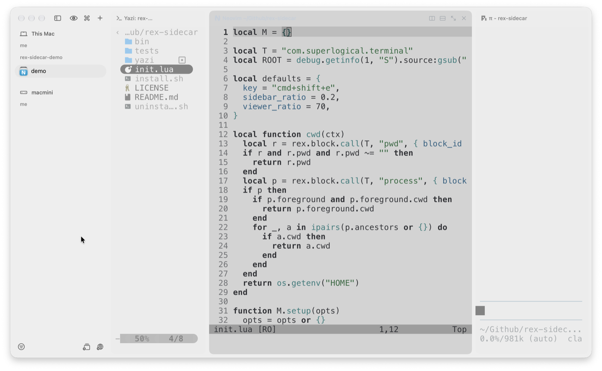

# rex-sidecar

A mouse-friendly file explorer and viewer for [Rex](https://www.superlogical.com/rex), the terminal multiplexer by [Superlogical](https://www.superlogical.com).

Press `Cmd+Shift+E`. A sidebar opens in the current directory. Click a file to
preview it next to the sidebar.



## Install

Install Rex first by following the [Rex installation guide](https://www.superlogical.com/rex/docs/installation). Then run:

```sh
curl -fsSL https://raw.githubusercontent.com/geminixiang/rex-sidecar/main/install.sh | sh
```

The installer uses Homebrew to add `yazi`, `neovim`, and `jq` if they are missing.
Run the same command again to update.

## Usage

- Click a folder to open it.
- Click a file to preview it.
- Click the `‹ path` header to go up a level.
- Right-click a file to focus the viewer.
- Files show git status markers.

## Configure

Add options to the `setup` call in `~/.config/rex/init.lua`:

```lua
require("rex-sidecar").setup{ key = "cmd+shift+e", sidebar_ratio = 0.2, viewer_ratio = 70 }
```

## Uninstall

```sh
sh ~/.config/rex/rex-sidecar/uninstall.sh
```

## Acknowledgements

Thanks to [Superlogical](https://www.superlogical.com) for building
[Rex](https://www.superlogical.com/rex), a great terminal multiplexer. Its Lua
config and open API made this project possible.

rex-sidecar is a community project. Superlogical does not maintain or endorse it.

## License

MIT
